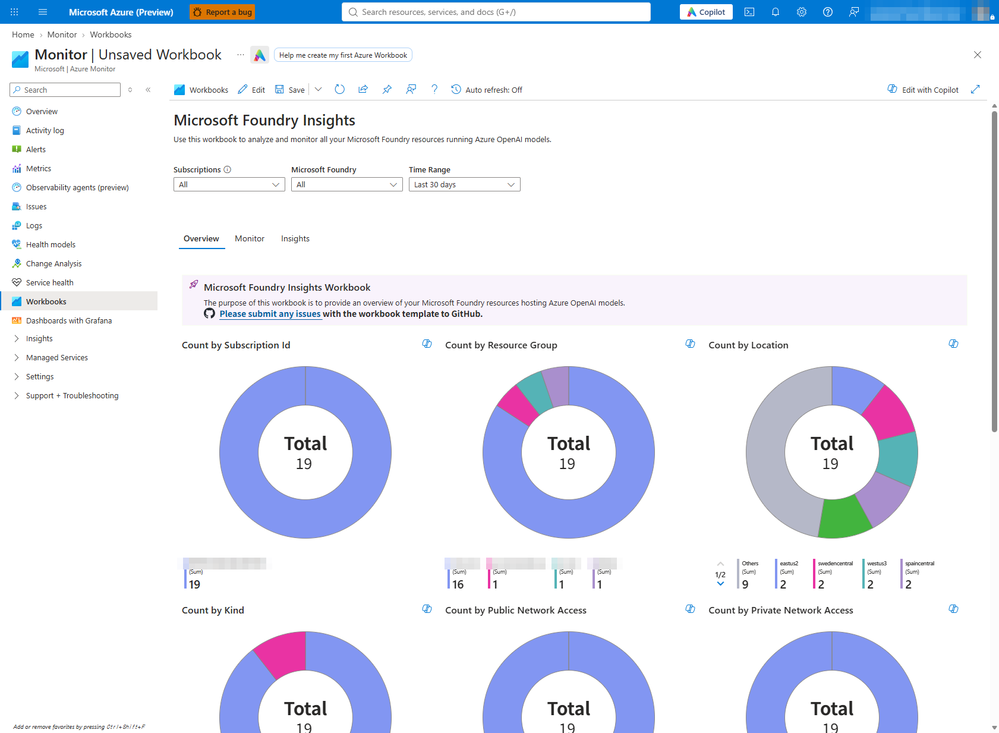
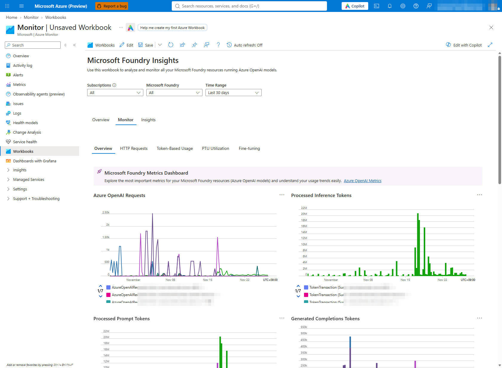
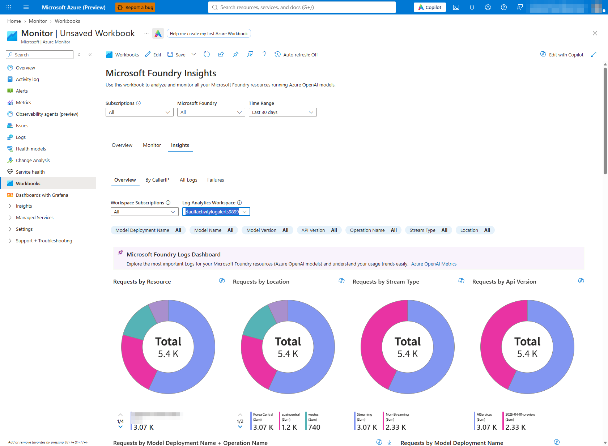
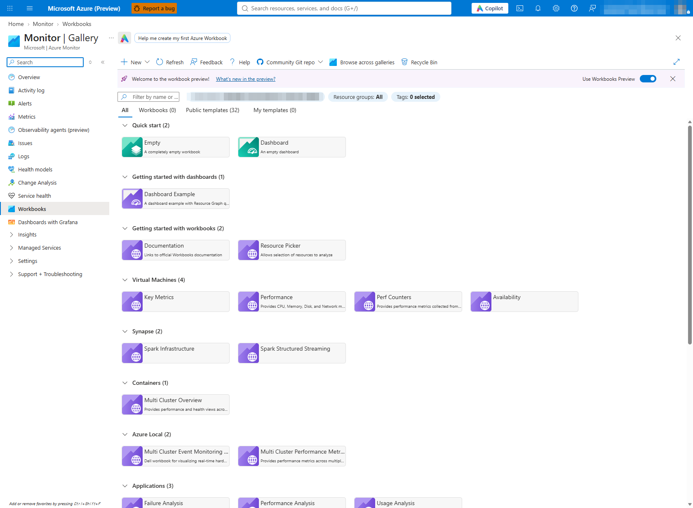
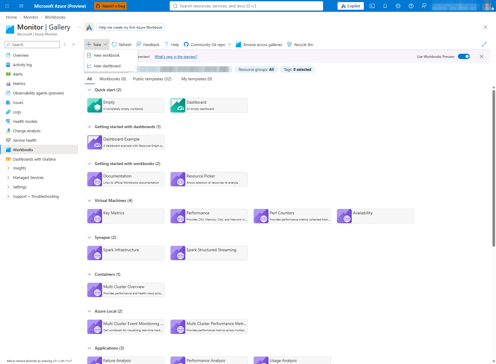
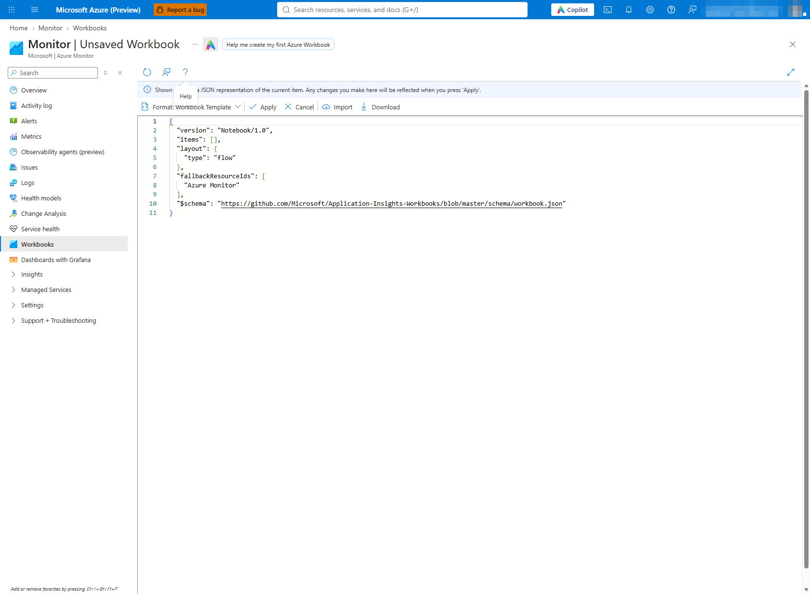
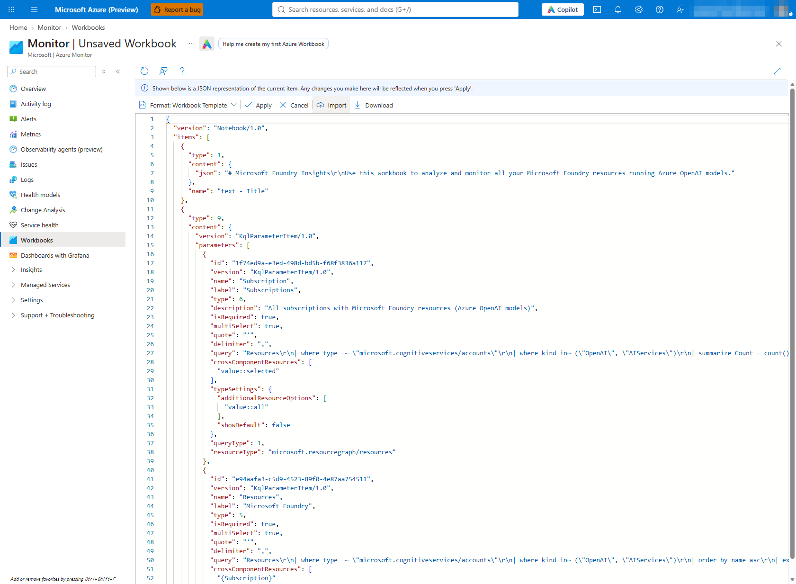
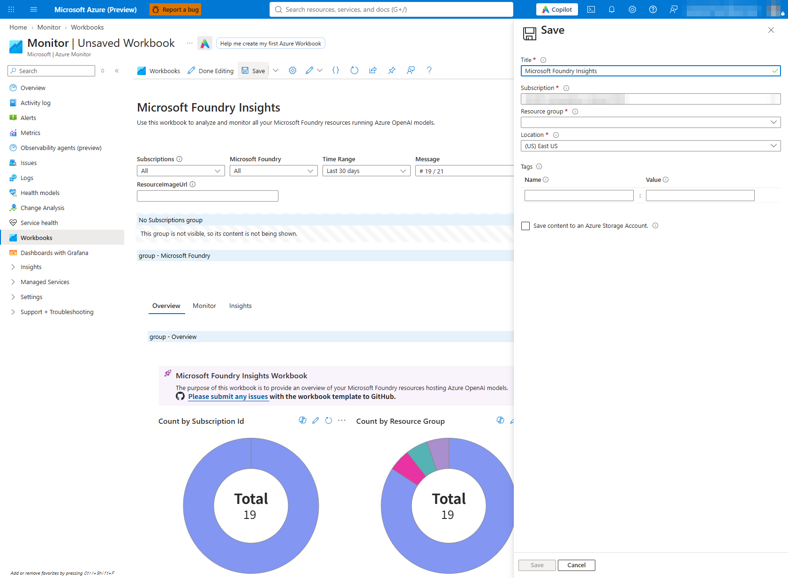

# Microsoft Foundry Insights
The 'Microsoft Foundry Insights' workbook offers deep insights into Azure OpenAI model usage running on Microsoft Foundry resources, helping you manage costs, optimize performance, and make strategic decisions for a robust AI infrastructure.

> Screenshot captured from a live Azure Portal deployment of this workbook. Subscription ID and resource group/resource names have been redacted.

## Introduction

In the ever-evolving world of Artificial Intelligence, organizations and entities across various sectors are on a quest to leverage advanced technologies efficiently. Microsoft Foundry opens a realm of possibilities for deploying and operating Azure OpenAI models, offering both challenges and excitement, particularly for those at the early stages of AI adoption.

Read more in depth in this Tech Community blog: [Azure OpenAI Insights: Monitoring AI with Confidence](https://techcommunity.microsoft.com/t5/fasttrack-for-azure/azure-openai-insights-monitoring-ai-with-confidence/ba-p/4026850)

This workbook offers deep insights into Microsoft Foundry resources hosting Azure OpenAI models and their usage (Platform Metrics and Logs) and can be a powerful tool in analyzing & monitoring your AI initiatives.

## Structure and Views 

### Structure

This workbook contains 3 main parts:
- **Overview** - Holistic view of Microsoft Foundry resources (Azure OpenAI models)
- **Monitor** - Holistic view of Microsoft Foundry resources Metrics
- **Insights** - Holistic view of Microsoft Foundry resources Logs
  - Requires by enabling Diagnostic Settings to Log Analytics Workspace.

### Views

Types of views this workbook provides:

- **Overview**
  - Microsoft Foundry Resources by
    - SubscriptionId
    - Resource Group
    - Location
    - Kind
    - Public Network Access
    - Private Network Access
  - All Microsoft Foundry Resources (resources of kind `OpenAI` and `AIServices` hosting Azure OpenAI models)

> The information displayed uses [KQL](https://learn.microsoft.com/en-us/azure/data-explorer/kusto/query/) queries to query the [Azure Resource Graph](https://learn.microsoft.com/en-us/azure/governance/resource-graph/overview).

- **Monitor**
  - Overview
    - Requests
    - Processed Inference Tokens
    - Processed Prompt Tokens
    - Generated Completions Tokens
    - Processed FineTuned Training Hours
    - Provisioned-managed Utilization
    - Active Tokens
    - Prompt Token Cache Match Rate
    - Time to Response
  - HTTP Requests
    - Requests
      - by Model Name
      - by Model Version
      - by Model Deployment Name
      - by Status Code
      - by StreamType
      - by Operation Name
      - by API Name
      - by Region
    - Time to Response
      - by Model Name
      - by Model Deployment Name
    - Prompt Token Cache Match Rate
      - by Model Name
      - by Model Deployment Name
  - Token-Based Usage
    - Processed Inference Tokens
      - by Model Name
      - by Model Deployment Name
    - Processed Prompt Tokens
      - by Model Name
      - by Model Deployment Name
    - Generate Completion Tokens
      - by Model Name
      - by Model Deployment Name
    - Active Tokens
      - by Model Name
      - by Model Deployment Name
  - PTU Utilization
    - Provisioned-managed Utilization
      - by Model Name
      - Model Version
      - by Model Deployment Name
      - by StreamType
      - by Region
  - Fine-tuning
    - Processed FineTuned Training Hours
      - by Model Name
      - by Model Deployment Name

> The information displayed uses Azure OpenAI Platform Metrics, emitted by Microsoft Foundry resources, and presented by multiple dimensions.

> Resource names in the legend have been redacted.

- **Insights**
  - Overview
    - Requests
      - by Resource
      - by Location
      - by StreamType
      - by Api Version
      - by Model Deployment Name + Operation Name
      - by Model Deployment Name
      - by Model Name + Operation Name
      - by Model Name
      - by Operation Name
      - by Avg Duration (ms)
      - by Avg Request Length (bytes)
      - by Avg Response Length (bytes)
  - By CallerIP
    - Requests
    - Operation Name
    - Model Deployment Name + Operation Name
    - Model Name + Operation Name
    - Avg Duration (ms)
    - Avg Request Length (bytes)
    - Avg Response Length (bytes)
  - All Logs
    - Successful requests
  - Failures
    - Failed requests
      - by Resources
      - by Api Version
      - by Operation name
      - by Stream Type

#### Filters

> Resource name in the legend and the account banner have been redacted.

This workbook support to filter all the logs by several fields:
- Model Deployment Name
- Model Name
- Model Version
- Api Version
- Operation Name
- Stream Type
- Location

All the filters are related to each other to allow a granular view and simplify the tracking of the logs.

> The information displayed uses [KQL](https://learn.microsoft.com/en-us/azure/data-explorer/kusto/query/) queries to query the Log Analytics Workspace that store the logs.
>> Note: The Logs will be available on resources that enabled Diagnostic Settings to Log Analytics Workspace.

<ins>Average Duration (ms)</ins>

<ins>Average Request / Response Length (bytes)</ins>

## How to use it?
Importing this Workbook to your Azure environment is quite simple.

Follow this steps to use the Workbook:

- Login to [Azure Portal](https://portal.azure.com/) 
- Go to _'Azure Workbooks'_, then click _'+ Create'_ and _'New workbook'_

- Open the Advanced Editor (the _'{}'_ button on the toolbar)

- Click _'Import'_ and select the downloaded [Microsoft Foundry Insights JSON](https://raw.githubusercontent.com/minuki/Azure-Foundry-Insights/main/Workbook/Azure%20OpenAI%20Insights.workbook) file (or paste its contents directly)
  - We use the _Gallery Template type_, so we need to use the _'Azure OpenAI Insights.workbook'_ and not the _'Azure OpenAI Insights.json'_.
- Click _'Apply'_

- Click the _'Save'_ button on the toolbar

- Select a name and where to save the Workbook:
  - Title: _'Microsoft Foundry Insights'_
  - Subscription: <_Subscription Name_>
  - Resource group: <_Resource Group Name_>
  - Location: <_Region_>
- Click _'Save'_
  
The Workbook is ready to use!
- Click on _'Workbooks'_
- Click on _'Microsoft Foundry Insights'_ Workbook.

Start using the Workbook and analyze your Microsoft Foundry resources running Azure OpenAI models. 

> (Optional) You can filter by specific subscription/s or resource/s.
> Note: Resources of kind `OpenAI` (dedicated Azure OpenAI resource) and `AIServices` (Microsoft Foundry resource) are both included.

